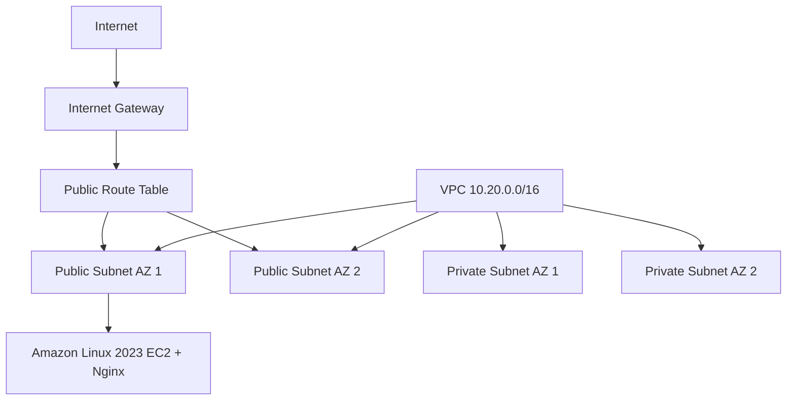

# AWS Infrastructure Automation with Terraform

A reproducible, GitHub-ready infrastructure-as-code project demonstrating AWS VPC networking, subnet design, EC2 provisioning, security groups, and automated configuration validation and a deployment smoke test.

> **Project status:** > Successfully validated and deployed to AWS in the `us-east-2` (Ohio) region on November 20, 2026. Terraform provisioned 11 infrastructure resources, including VPC networking and an EC2 web server. Deployment outputs were captured, and all 11 Terraform-managed resources were subsequently destroyed to prevent ongoing infrastructure costs. GitHub Actions Terraform validation passed. This is a demonstration project, not a production deployment.

## Architecture



Private subnets have no NAT gateway or outbound internet route by design to minimize ongoing cost. No instances are deployed in private subnets.

## Prerequisites

- Terraform >= 1.6
- AWS account and CLI credentials with permission to provision VPC, EC2, security group, and networking resources
- An AWS region with at least two availability zones

## Deploy

```bash
cd terraform
cp terraform.tfvars.example terraform.tfvars
terraform fmt
terraform init
terraform validate
terraform plan -out=deploy.tfplan
terraform apply deploy.tfplan
terraform output web_url
```

Visit the URL after EC2 user-data has completed. HTTP is intentionally public for demonstration; SSH is disabled by default. There is no inbound SSH rule. For administrative access, prefer AWS Systems Manager Session Manager after configuring the necessary IAM permissions and connectivity (not included in this minimal demo).

## Validate

```bash
terraform fmt -check
terraform validate
terraform plan
bash ../scripts/smoke-test.sh
```

The GitHub Actions workflow runs formatting and validation checks on pushes and pull requests; it does not deploy to AWS and needs no AWS credentials.

## Cost and cleanup

**AWS resources may incur charges**, including EC2, EBS, and public IPv4 addressing. Check current AWS pricing and your billing dashboard before deployment. To delete resources:

```bash
terraform destroy
```

## Security notes

- IMDSv2 required for EC2 metadata.
- Encrypted EBS root volume.
- SSH blocked by default.
- Terraform state and local variable files ignored by Git.
- HTTP-only demo, not production-ready: add HTTPS, logging, private application tiers, and remote state management for real workloads.

## Portfolio description

Designed, deployed, and validated an AWS infrastructure environment using Terraform, including a custom VPC, multi-Availability-Zone public and private subnets, EC2 web hosting, security groups, and encrypted storage. Integrated GitHub Actions for automated Terraform formatting and validation. Successfully provisioned 11 AWS resources, verified deployment outputs, and performed infrastructure teardown using Terraform. Demonstrated infrastructure-as-code automation, AWS networking, CI/CD validation, and cost-conscious cloud resource management.


## Verification checklist

- [x] Local Python repository tests (3 passing)
- [x] Bash syntax check (`bash -n`)
- [x] GitHub Actions Terraform `fmt` and `validate` green
- [x] AWS `terraform plan` reviewed
- [x] AWS `terraform apply` succeeds
- [x] AWS deployment outputs captured
- [x] `terraform destroy` completes (11 resources destroyed)
- [x] AWS billing checked ($0.00 estimated bill at time of verification)
- [ ] Live HTTP smoke test passes (not independently confirmed)

**Portfolio integrity:** AWS deployment and infrastructure cleanup were successfully completed. Live HTTP smoke-test success has not been independently verified. This is a demonstration environment, not a hardened production deployment.

