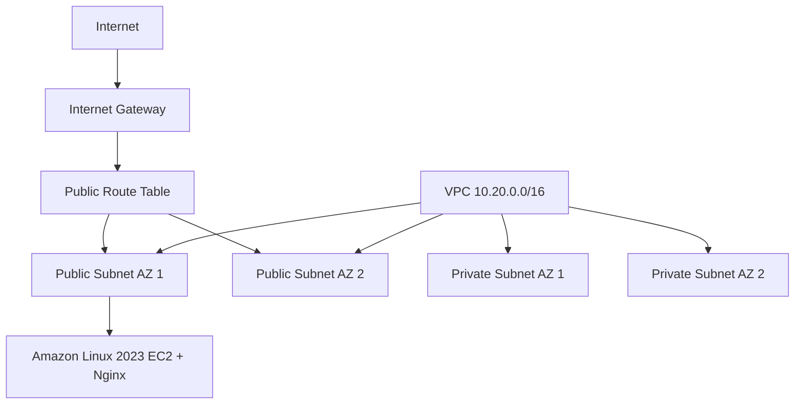

# AWS Infrastructure Automation with Terraform

A reproducible, GitHub-ready infrastructure-as-code project demonstrating AWS VPC networking, subnet design, EC2 provisioning, security groups, and automated configuration validation and a deployment smoke test.

> **Project status:** Implementation updated and local repository tests passed (3/3); shell syntax checks passed. Terraform CLI validation and AWS deployment have **not** been performed. GitHub Actions validation will run after pushing the repository. Do not describe this as a production deployment.

## Architecture



Private subnets have no NAT gateway or outbound internet route by design to minimize ongoing cost. No instances are deployed in private subnets.

## Prerequisites

- Terraform >= 1.6
- AWS account and CLI credentials with permission to provision VPC, EC2, security group, and networking resources
- An AWS region with at least two availability zones

## Deploy

```bash
cd terraform
cp terraform.tfvars.example terraform.tfvars
terraform fmt
terraform init
terraform validate
terraform plan -out=deploy.tfplan
terraform apply deploy.tfplan
terraform output web_url
```

Visit the URL after EC2 user-data has completed. HTTP is intentionally public for demonstration; SSH is disabled by default. There is no inbound SSH rule. For administrative access, prefer AWS Systems Manager Session Manager after configuring the necessary IAM permissions and connectivity (not included in this minimal demo).

## Validate

```bash
terraform fmt -check
terraform validate
terraform plan
bash ../scripts/smoke-test.sh
```

The GitHub Actions workflow runs formatting and validation checks on pushes and pull requests; it does not deploy to AWS and needs no AWS credentials.

## Cost and cleanup

**AWS resources may incur charges**, including EC2, EBS, and public IPv4 addressing. Check current AWS pricing and your billing dashboard before deployment. To delete resources:

```bash
terraform destroy
```

## Security notes

- IMDSv2 required for EC2 metadata.
- Encrypted EBS root volume.
- SSH blocked by default.
- Terraform state and local variable files ignored by Git.
- HTTP-only demo, not production-ready: add HTTPS, logging, private application tiers, and remote state management for real workloads.

## Portfolio description

Designed a reproducible AWS network and EC2 web-hosting environment with Terraform, including multi-AZ subnet layout, least-privilege SSH access controls, encrypted storage, and CI-based Terraform validation. Source implementation available; cloud deployment not yet verified.

## Verification checklist

- [x] Local Python repository tests (3 passing)
- [x] Bash syntax check (`bash -n`)
- [ ] GitHub Actions Terraform `fmt` and `validate` green
- [ ] AWS `terraform plan` reviewed
- [ ] AWS `terraform apply` succeeds
- [ ] Live HTTP smoke test passes
- [ ] `terraform destroy` completes and AWS billing checked

**Portfolio integrity:** Do not claim this infrastructure has been deployed or production-tested until those steps are completed. The project is a reference implementation, not a hardened production stack.
